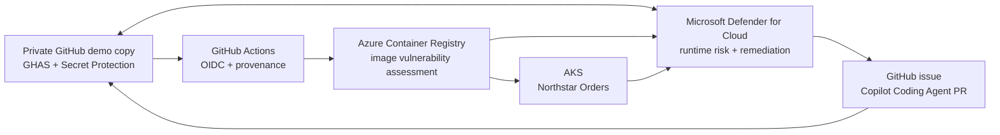

# Northstar Orders: GHAS + Defender for Cloud demo

Northstar Orders is an enterprise inner-source reference that demonstrates how
GitHub Advanced Security (GHAS) and Microsoft Defender for Cloud connect source,
build, registry, and runtime context to prioritize and remediate a deployed
security finding.

The reference is published for community reuse: enterprise teams can exercise it
as inner source, while open-source maintainers can apply the same provenance,
prioritization, and remediation principles to public projects.

> [!CAUTION]
> This repository deliberately contains documented vulnerabilities. It is an
> educational demo, **not a production template**. Deploy it only from a
> disposable private copy, use synthetic data, and delete the environment after
> the demonstration.

## What the demo shows

- A TypeScript application scanned by CodeQL, Dependabot, and secret scanning.
- A GitHub Actions build authenticated to Azure with OIDC rather than a stored
  registry password.
- An attested container image traced from GitHub to Azure Container Registry
  (ACR) and a running Azure Kubernetes Service (AKS) workload.
- Microsoft Defender for Cloud runtime context such as internet exposure and
  business criticality.
- A container CVE correlated with its Dependabot alert, assigned through a
  Defender-generated GitHub issue, and remediated by Copilot Coding Agent.
- A clear handoff between cloud security, application security, and developers.

## Architecture



See [the detailed architecture](docs/architecture.md) for trust boundaries and
data flow.

## Deliberate findings

| Scenario | Primary experience | Purpose |
| --- | --- | --- |
| Constrained SQL injection over synthetic, read-only data | CodeQL and Copilot Autofix | Demonstrate developer remediation and a security regression test |
| Direct npm dependency with an active CVE | Dependabot + Defender container VA | Demonstrate the native code-to-runtime correlation and issue handoff |
| Newly generated, unregistered private key | Generic secret scanning + push protection | Demonstrate an adjacent GHAS prevention and triage workflow |

The dependency/CVE scenario is the direct Defender runtime-correlation story.
The secret canary is intentionally presented as a separate GHAS capability.

## Prerequisites

- A commercial Azure subscription with Defender CSPM enabled.
- Permissions to create the demo Azure resources and view Defender findings.
- A GitHub organization where you are an owner.
- GitHub Code Security, GitHub Secret Protection, and Copilot Coding Agent.
- Azure CLI, GitHub CLI, Docker, kubectl, Node.js 24 LTS, and npm.

Paid plans, the Defender GitHub connector, agentless scanning, and repository
security settings require explicit administrator approval. The infrastructure
code does not silently enable them.

## Start here

1. Read the [safety boundaries and production gaps](docs/safety-and-production-gaps.md).
2. Create a **private, disposable copy** of this public reference in the licensed
   GitHub organization.
3. Follow [the setup guide](docs/setup.md) to authorize the GitHub connector,
   provision ACR and AKS, configure repository security, and deploy the image.
4. Use [the presenter runbook](docs/presenter-runbook.md) for the persona-led
   code-to-cloud story.
5. Follow [the cleanup guide](docs/cleanup.md) immediately after the demo.

Defender and GitHub enrichment is asynchronous. Prepare and verify the
environment before a live session rather than relying on an immediate portal
update.

## Local development

```powershell
npm ci
npm run lint
npm run typecheck
npm run build
npm test
npm start
```

The normal checks pass in the seeded demo state. `npm run test:security` is the
remediation acceptance test and deliberately fails until the SQL injection is
fixed correctly.

Run the local/cloud tooling check with:

```powershell
node scripts/preflight.mjs --cloud
```

## Documentation

- [Architecture](docs/architecture.md)
- [Setup](docs/setup.md)
- [Presenter runbook](docs/presenter-runbook.md)
- [Findings catalog](docs/findings-catalog.md)
- [Troubleshooting](docs/troubleshooting.md)
- [Safety and production gaps](docs/safety-and-production-gaps.md)
- [Cleanup](docs/cleanup.md)
- [Security policy](SECURITY.md)
- [Contributing](CONTRIBUTING.md)

## Official references

- [GHAS integration with Microsoft Defender for Cloud](https://learn.microsoft.com/azure/defender-for-cloud/github-advanced-security-overview)
- [Deploy the GHAS integration](https://learn.microsoft.com/azure/defender-for-cloud/github-advanced-security-deploy)
- [Map container images from code to runtime](https://learn.microsoft.com/azure/defender-for-cloud/container-image-mapping)
- [Use code-to-runtime visibility](https://learn.microsoft.com/azure/defender-for-cloud/code-to-runtime-mapping)
- [GitHub artifact attestations](https://docs.github.com/actions/security-guides/using-artifact-attestations-to-establish-provenance-for-builds)

## License

[MIT](LICENSE)
